# HyperPod 분산 학습 인프라 — 실습 가이드

AWS SageMaker HyperPod 기반 Physical AI (VLA/RL) 분산 학습 환경을 배포하고, 데이터 준비부터 학습 실행, MLflow 모니터링까지 전체 파이프라인을 실습합니다.

> 이 문서는 [README.md](README.md)(영문)의 한국어 번역본입니다. 상세 원문은 영문 README를 기준으로 삼으세요.

## 아키텍처 요약

```
┌───────────────────────────────────────────────────────────────────────────┐
│ HyperPod Cluster (SLURM Managed)                                          │
│  ├─ head   (ml.m5.xlarge) — 컨트롤러, 상시 운영                           │
│  ├─ gpu-g5-8x (ml.g5.8xlarge) — RL 학습 (0에서, debug 와 같은 타입)       │
│  │     -c gpuGroups=extended: g6e/g6/g7e/p4d/p5 그룹 추가                 │
│  │     (전부 노드 0에서 시작)                                             │
│  ├─ cpu-c5-4x / cpu-c5-9x / cpu-m5-4x — MuJoCo RL (CPU, 파티션 cpu, 0에서)│
│  └─ debug  (ml.g5.8xlarge)    — 디버깅/시각화 (0에서)                     │
├───────────────────────────────────────────────────────────────────────────┤
│ Storage                                                                   │
│  ├─ FSx for Lustre (1.2TB) ← /fsx 마운트                                  │
│  └─ S3 Data Bucket ↔ FSx 자동 동기화                                      │
├───────────────────────────────────────────────────────────────────────────┤
│ MLflow Tracking Server (SageMaker Managed)                                │
└───────────────────────────────────────────────────────────────────────────┘
```

## 사전 준비

- AWS CLI v2 + credentials 설정 완료
- Node.js 18+ / npm
- AWS CDK CLI (`npm install -g aws-cdk`)
- Session Manager Plugin ([설치 가이드](https://docs.aws.amazon.com/systems-manager/latest/userguide/session-manager-working-with-install-plugin.html))
- 리전: `us-east-1` (배포 전 GPU 쿼터 확인 — 아래 참고)

---

## Step 1: CDK 프로젝트 설정

```bash
cd hyperpod-training/infra
npm install
```

CDK Bootstrap (최초 1회):
```bash
cdk bootstrap aws://ACCOUNT_ID/us-east-1
```

## Step 2: 인프라 배포

### 기본 배포

```bash
npx cdk deploy -c region=us-east-1 --require-approval never
```

### 배포 파라미터 커스터마이즈

`bin/app.ts`가 읽는 CDK context 파라미터입니다.

| 파라미터 | 기본값 | 설명 |
|---------|--------|------|
| `region` | `CDK_DEFAULT_REGION` | 배포 리전. `personal` 프로필은 리전 제약이 없고 us-east-1 / us-west-2 / ap-northeast-2(서울)에서 배포를 검증했다. `workshop-studio`는 us-east-1/us-west-2만 허용 |
| `createVpc` | true | VPC를 새로 생성 (false면 기존 VPC 사용) |
| `vpcCidr` | 10.0.0.0/16 | 생성할 VPC의 CIDR |
| `gpuMaxCount` | 4 | GPU 인스턴스 타입별 그룹의 최대 노드 수 |
| `gpuGroups` | core | GPU 그룹 프로필. `core` = gpu-g5-8x 하나(Workshop Studio SageMaker 허용 목록 호환), `extended` = g6e/g6/g7e/p4d/p5 그룹 추가 |
| `profile` | personal | 배포 프로필. `workshop-studio` = Workshop Studio 이벤트 계정(us-east-1/us-west-2에서만). head 노드는 두 프로필 모두 `ml.m5.xlarge` — 실측한 WS 계정 cluster usage 쿼터가 m5.xlarge 10, g5.* 0이었다 |
| `gpuCount` | 0 | 기본 학습 그룹(gpu-g5-8x, ml.g5.8xlarge)에서 기동할 노드 수 (배포 후에는 `scripts/scale-cluster.sh` 사용 권장) |
| `cpuMaxCount` | 2 | CPU 그룹(cpu-c5-4x / cpu-c5-9x / cpu-m5-4x) 각각의 최대 노드 수 |
| `cpuCount` | 0 | 기본 CPU 학습 그룹(cpu-c5-4x, ml.c5.4xlarge — MuJoCo RL)에서 기동할 노드 수 |
| `debugCount` | 0 | debug(DCV) 그룹에서 기동할 노드 수 (0 또는 1) |
| `gpuUseSpot` | false | GPU 그룹에 Spot 인스턴스 사용 |
| `fsxCapacityGiB` | 1200 | FSx 스토리지 용량 (GiB) |
| `enableMlflow` | false | (옵션) 관리형 MLflow 실험 추적 서버 생성 여부 |
| `amiUpdateSchedule` | (꺼짐) | AMI 보안 패치 스케줄. `default`(`cron(00 18 ? * 1#2 *)`) 또는 cron 식으로 켠다. 켜면 이후 `cdk deploy`가 HyperPod의 ScheduledUpdateConfig 수정 거부로 실패하므로 기본은 꺼짐 |

예시 — 소규모 테스트:
```bash
npx cdk deploy \
  -c region=us-east-1 \
  -c gpuMaxCount=1 \
  -c fsxCapacityGiB=1200 \
  --require-approval never
```

> **GPU 쿼터 확인 필수.** GPU 인스턴스 그룹은 `lib/config/cluster-config.ts`의
> 프로필(`core`: g5-8x / `extended`: + g6e/g6/g7e/p4d/p5)대로 타입별로 하나씩 생성되며, 초기 노드 수는
> 모두 0입니다. 쿼터가 0인 타입은 job이 영구히 `PENDING`에 머무르므로 배포 전에 확인하세요.
>
> ```bash
> aws service-quotas list-service-quotas --service-code sagemaker --region us-east-1 \
>   --query "Quotas[?contains(QuotaName,'cluster usage') && Value>\`0\`].[QuotaName,Value]" --output text
> ```

### 배포 확인 (약 20분 소요)

```bash
# 스택 상태 확인
aws cloudformation describe-stacks \
  --stack-name HyperPod-<ACCOUNT_ID> \
  --region us-east-1 \
  --query "Stacks[0].StackStatus"

# 출력값 확인
aws cloudformation describe-stacks \
  --stack-name HyperPod-<ACCOUNT_ID> \
  --region us-east-1 \
  --query "Stacks[0].Outputs"
```

## head node 접속 (head-node.sh)

HyperPod 노드는 private subnet에 있고 SSM target 형식이
`sagemaker-cluster:<CLUSTER_ID>_head-<INSTANCE_ID>`입니다. 스크립트가 두 ID를 조회해 target을 조립하고,
`AWS-StartInteractiveCommand` + `sudo -iu ubuntu`로 세션을 곧바로 `ubuntu` 사용자 셸로 열어 접속 후
`sudo su - ubuntu`가 필요 없습니다:

```bash
./scripts/head-node.sh                  # head node 에 ubuntu 로 접속 ($REGION, hyperpod-<ACCOUNT_ID> 사용)
./scripts/head-node.sh --print-target   # 접속하지 않고 SSM target 만 출력 (포트포워딩 등에 사용)
./scripts/head-node.sh --root           # root 세션
./scripts/head-node.sh --cluster hyperpod-eks-<ACCOUNT_ID> --region us-west-2
```

## GPU 노드 스케일 업/다운 (scale-cluster.sh)

GPU 인스턴스 그룹은 배포 직후 노드 수 0으로 시작합니다 (비용 0). 학습 직전에
노드를 올리고, 끝나면 다시 0으로 내립니다. CDK 재배포 없이
`aws sagemaker update-cluster`를 감싼 스크립트를 사용하세요:

```bash
# 학습용 GPU 노드 1대 기동 (InService까지 대기, 10~20분)
./scripts/scale-cluster.sh gpu-g5-8x 1 --wait

# 학습 종료 후 0으로 축소
./scripts/scale-cluster.sh gpu-g5-8x 0

# DCV 디버그 노드 (시각화 검증)
./scripts/scale-cluster.sh debug 1 --wait

# MuJoCo RL 용 CPU 노드 (Slurm 경로, Slurm 경로 S3)
./scripts/scale-cluster.sh cpu-c5-4x 1 --wait
```

> 스크립트는 CloudFormation 밖에서 노드 수를 바꾸므로 CDK 스택과 드리프트가 생깁니다.
> 이후 `cdk deploy`를 다시 실행하면 노드 수가 context 값(기본 0)으로 되돌아가고,
> `cdk destroy`에는 영향이 없습니다. IaC로 일관되게 관리하고 싶다면
> `-c gpuCount=1` 재배포 방식도 유효합니다(이때 기존 배포에 사용한 다른 context
> 값들을 반드시 함께 지정).

## MuJoCo (CPU) RL — GPU 노드 없이 학습·검증 (Slurm 경로 S3)

`ml.g5.*` cluster 쿼터가 0인 계정(Workshop Studio 이벤트 계정 등)을 위한 경로. CPU 그룹
(`cpu-c5-4x`, 16 vCPU)에서 SO-101 Reach 태스크를 MuJoCo + Stable-Baselines3(PPO)로 학습하고,
오프스크린 렌더링으로 mp4/gif를 만들어 검증한다. 관측·행동·보상은 Isaac Lab Reach와 동일하게 설계.

```bash
# [code-server] CPU 노드 기동 (5~10분)
./scripts/scale-cluster.sh cpu-c5-4x 1 --wait

# [head node] 최초 1회: /fsx/envs/mujoco venv + mujoco_menagerie(robotstudio_so101) + 태스크 패키지
bash /fsx/scratch/aws-physical-ai-recipes/hyperpod-training/scripts/setup_mujoco_env.sh

# [head node] 학습 (cpu 파티션, 1M 스텝 ≈ 5분) → /fsx/checkpoints/rl/reach-mujoco/SO101_Reach/
sbatch slurm-templates/rl/train_mujoco.sbatch          # TASK / NUM_ENVS / TOTAL_STEPS / CHECKPOINT
slurm-templates/rl/run_mujoco.sh --steps 3000000        # 래퍼

# [head node] 평가 + 영상 (model_best.zip → videos/model_best.{mp4,gif}, S3 로 동기화)
sbatch slurm-templates/rl/play_mujoco.sbatch           # CHECKPOINT / EPISODES / MUJOCO_GL
CHECKPOINT=untrained EPISODES=2 sbatch slurm-templates/rl/play_mujoco.sbatch   # 학습 전 비교 영상 (videos/untrained.gif)

# [head node] 영상 대신 실시간으로: CPU 노드의 DCV 데스크톱(xfce + Mesa, GPU 없음)에 접속한 뒤
# 그 안에서 python examples/rl/play_mujoco.py --viewer --checkpoint <model.zip>
sbatch slurm-templates/debug/dcv_session_cpu.sbatch  # SSM 포트포워딩 + 뷰어 명령을 로그로 출력

# [code-server] 끝나면 0으로
./scripts/scale-cluster.sh cpu-c5-4x 0
```

| 파일 | 역할 |
|---|---|
| `mujoco-workshop/` | `Workshop-SO101-Reach-MuJoCo-v0` Gymnasium 태스크 패키지 (`so101_reach.py`) |
| `scripts/setup_mujoco_env.sh` | FSx venv 생성, menagerie 고정 커밋 sparse checkout, 패키지 설치, smoke test (head node에서 실행) |
| `examples/rl/train_mujoco.py` | SB3 PPO + SubprocVecEnv(vCPU당 1 프로세스) + VecNormalize, model_best.zip 선택, TensorBoard `reward_terms/` |
| `examples/rl/play_mujoco.py` | 결정적 평가(성공률·최종 거리) + `MUJOCO_GL=egl` 오프스크린 mp4/gif, `--untrained`로 학습 전 비교 영상, `--viewer`로 DCV 데스크톱에 실시간 MuJoCo 창 |
| `slurm-templates/rl/train_mujoco.sbatch`, `play_mujoco.sbatch`, `run_mujoco.sh` | `--partition=cpu` Slurm 템플릿 |
| `slurm-templates/debug/dcv_session_cpu.sbatch` | CPU 노드 DCV 세션(setup_dcv.sh가 CPU 노드에도 xfce + DCV 설치); SSM target과 `--viewer` 명령을 출력 |

## EKS 오케스트레이션 경로 — observability · task governance (워크숍 모듈 8~11, RL 트랙 메인 경로)

같은 CDK 앱에 `-c orchestrator=eks`를 주면 Slurm 스택과 별개로 **EKS 오케스트레이션 HyperPod** 스택
`HyperPodEks-<ACCOUNT_ID>`(클러스터 `hyperpod-eks-<ACCOUNT_ID>`)를 배포한다. Slurm 경로에서 소개만 하고
넘어간 두 운영 축을 실제로 쓴다.

- **Observability** — EKS 애드온 `amazon-sagemaker-hyperpod-observability` + Amazon Managed Service for
  Prometheus(AMP) + Grafana. 이 애드온은 리전마다 제공 여부가 달라 CDK 스택에 넣지 않고, 배포 후
  `./scripts/eks/install-observability.sh`로 AMP 워크스페이스·애드온·Grafana(기본: 클러스터 안 Helm 설치,
  AMP를 SigV4로 읽음)를 한 번에 추가 설치한다. IAM Identity Center 조직 인스턴스가 있는 계정은
  `--grafana amg`로 Amazon Managed Grafana를 대신 쓸 수 있다.
- **Task governance** — EKS 애드온 `amazon-sagemaker-hyperpod-taskgovernance`(Kueue). cluster policy(우선순위
  클래스)와 팀별 compute quota를 CLI로 만들면 팀 네임스페이스·LocalQueue가 자동 생성되고, Job은 큐를 거쳐
  할당량·우선순위에 따라 실행·대기·선점된다.

```
┌────────────────────────────────────────────────────────────────────┐
│ EKS 컨트롤 플레인 (hyperpod-eks-<ACCOUNT_ID>, K8s 1.35)            │
│   HyperPodHelmChart: HMA, deep health check, nvidia/EFA plugin,    │
│   Kubeflow training/MPI operator                                   │
│   애드온: pod-identity-agent, aws-fsx-csi-driver,                  │
│           hyperpod-taskgovernance(Kueue)                           │
│           (+ hyperpod-observability: install-observability.sh)     │
├────────────────────────────────────────────────────────────────────┤
│ HyperPod 인스턴스 그룹 (NodeProvisioningMode: Continuous)          │
│  ├─ cpu-c5-4x  (ml.c5.4xlarge) ×1 상시 — 애드온 파드 + MuJoCo CPU  │
│  └─ gpu-g5-8x  (ml.g5.8xlarge) ×0 — Isaac Lab RL (scale-cluster.sh)│
├────────────────────────────────────────────────────────────────────┤
│ FSx for Lustre (/fsx, CSI 정적 PV) ↔ S3 hyperpod-eks-data-…        │
│ AMP 워크스페이스 → Grafana (추가 설치, port-forward | AMG 옵션)    │
└────────────────────────────────────────────────────────────────────┘
```

두 프로필 모두 배포할 수 있다. `profile=workshop-studio`(이벤트 계정)는 GPU cluster 쿼터가 0이므로 GPU 그룹은 0대로 두고
상시 시스템 그룹 cpu-c5-4x(ml.c5.4xlarge) 1대에서 MuJoCo CPU 경로(모듈 9)로 학습·검증하고, 모듈 11에서 2대로 올려 거버넌스·관측 실습을 진행한다. 이벤트에서는 프로비저너
템플릿(`physical-ai-on-aws/static/e2e-workshop-provisioner.yaml`)의 `DeployHyperPodEks=true`가 이 스택을 미리 배포한다.

### 배포

```bash
cd hyperpod-training/infra
npm install
npx cdk deploy -c orchestrator=eks -c region=${REGION} --require-approval never   # ~35분
```

| 파라미터 | 기본값 | 설명 |
|---------|--------|------|
| `orchestrator` | `slurm` | `eks`로 지정 |
| `eksVersion` | `1.35` | Kubernetes 버전(`1.34` 또는 `1.35`). 상한은 EKS가 아니라 HyperPod EKS AMI가 정한다 — AMI 1.3.x는 1.30~1.35용으로만 빌드되어 1.36+ 클러스터에는 노드가 조인하지 못한다. 하한은 task governance 애드온의 Kueue 0.19가 요구하는 `resource.k8s.io/v1`(1.34+)이다 |
| `eksAdminArns` | (배포자) | 클러스터 admin 액세스 엔트리를 추가로 줄 IAM principal ARN, 쉼표 구분. 배포자는 `aws sts get-caller-identity`로 자동 포함 |
| `systemNodeCount` | 1 | 상시 시스템 노드(cpu-c5-4x) 수. 애드온은 노드가 1대 이상(4xlarge 이상) 있어야 설치된다 |
| `enableTaskGovernance` | true | task governance 애드온. observability 는 스택이 아니라 `scripts/eks/install-observability.sh` 로 추가 설치한다 |
| `deepHealthChecks` | false | GPU 그룹 `OnStartDeepHealthChecks`(InstanceStress, InstanceConnectivity). 켜면 노드 기동이 길어진다 |
| `enableMlflow` | false | (옵션) SageMaker 관리형 MLflow 실험 추적 서버. 켜면 학습 파드용 pod identity(네임스페이스 `rl`, `hyperpod-ns-team-a/b` 의 `default` ServiceAccount)와 `MlflowTrackingUri` Output 까지 함께 만든다. 서버는 상시 과금이다. ap-northeast-2 에는 없으므로 그 리전에서는 `scripts/eks/install-mlflow-selfhosted.sh` 를 쓴다 |
| `gpuGroups`, `gpuMaxCount`, `gpuCount`, `gpuUseSpot`, `fsxCapacityGiB`, `vpcCidr` | Slurm과 동일 | |

주요 Output: `KubeconfigCommand`, `ClusterName`, `ClusterArn`, `S3BucketName`,
`FsxFileSystemId`/`FsxDnsName`/`FsxMountName`,
`MlflowTrackingUri`/`MlflowPresignedUrlCommand`(`enableMlflow=true` 일 때).

`enableMlflow=true` 로 배포하면 `render.sh` 가 `MlflowTrackingUri` Output 을 읽어
`rl/isaaclab-train-job.yaml` 의 `MLFLOW_TRACKING_URI` 를 자동으로 채운다. Slurm 경로와 달리 EKS
파드는 노드 execution role 을 물려받지 못하고 인스턴스 메타데이터 서비스(IMDS)도 막혀 있어 pod
identity 가 유일한 자격증명 경로다. MLflow 패키지도 컨테이너에 없으므로 Job 시작 시
`mlflow-skinny` + `sagemaker-mlflow` 를 설치한다(전체 `mlflow` 는 numpy 2 를 끌어와 Isaac Sim 의
numpy 1.26 빌드를 깬다). MLflow UI 는 `MlflowPresignedUrlCommand` Output 의 명령으로 presigned URL
을 만들어 연다.

선택지가 하나 더 있다. `scripts/eks/install-mlflow-selfhosted.sh` 는 클러스터 안에 MLflow 서버를
직접 띄운다(백엔드는 gp3 PVC 의 Postgres, 아티팩트는 스택의 S3 버킷, 접근은 basic auth). `render.sh`
는 `mlflow` 네임스페이스에 `svc/mlflow` 가 있으면 그쪽을 우선 쓰고 없으면 스택 Output 으로
되돌아가므로, 서버를 바꿀 때 템플릿을 고칠 필요는 없다. SageMaker 관리형 MLflow 가 없는
ap-northeast-2 에서는 이 자체 호스팅 쪽이 유일한 방법이다.

### 배포 후

```bash
cd hyperpod-training
./scripts/eks/kubeconfig.sh                       # kubectl 컨텍스트 hyperpod-eks + 노드/애드온 확인
./scripts/eks/install-observability.sh            # AMP + observability 애드온 + Grafana (~5분)
kubectl port-forward -n grafana svc/grafana 3000:80 &   # Grafana → https://<CodeServerUrl>/absproxy/3000/ 또는 http://localhost:3000/absproxy/3000/ (admin / Secret grafana 의 admin-password)
kubectl get secret -n grafana grafana -o jsonpath='{.data.admin-password}' | base64 -d; echo
# Amazon Managed Grafana 를 쓰려면: ./scripts/eks/install-observability.sh --grafana amg
#                                   ./scripts/eks/grafana-user.sh <IdC-username>  → 출력된 URL 로 로그인
```

observability 애드온이 없는 리전(ap-northeast-2)에는 대시보드 스택 전체를 클러스터 안에 올리고
CloudFront URL 하나로 공개하는 두 번째 경로가 있다.

```bash
./scripts/eks/install-dashboard-public.sh         # kube-prometheus-stack + Grafana + ALB + WAF + CloudFront (~25분)
./scripts/eks/install-mlflow-selfhosted.sh        # 같은 ALB 에 MLflow + Postgres + TensorBoard (~10분)
./scripts/eks/install-unified-dashboard.sh        # 세 UI 앞에 랜딩 페이지 하나 (~3분, 새 비용 없음)
./scripts/eks/install-dashboard-hardening.sh      # (옵션) 지표 보존 + 알림 (~10분, 약 \$5/월)
./scripts/eks/install-job-portal.sh               # (옵션) 브라우저에서 Job 제출 (~8분, 새 비용 없음)
./scripts/eks/install-logs.sh                     # (옵션) 끝난 Job 의 로그를 S3 에 보관 (~8분, 약 \$2/월)
# → https://<cloudfront-도메인>/            Grafana     클러스터 상태 + 입구 (admin / Secret grafana 의 admin-password)
#   https://<cloudfront-도메인>/mlflow      MLflow      학습 지표 — run 은 여기서 읽는다 (basic auth, 설치 스크립트가 출력)
#   https://<cloudfront-도메인>/tensorboard TensorBoard 폴백 — /fsx tfevents, MLflow 에 없는 run 용
#   https://<cloudfront-도메인>/argo        Argo        Job 제출·진행 확인 (로그인 토큰은 설치 스크립트가 출력)
./scripts/eks/delete-logs.sh                      # 삭제는 설치의 역순
./scripts/eks/delete-job-portal.sh
./scripts/eks/delete-dashboard-hardening.sh
./scripts/eks/delete-unified-dashboard.sh
./scripts/eks/delete-mlflow-selfhosted.sh
./scripts/eks/delete-dashboard-public.sh          # 같은 그룹에 Ingress 가 남아 있으면 ALB 가 유지된다
```

두 스크립트는 Ingress 를 같은 `hyperpod-dashboard` IngressGroup 에 붙이므로 ALB 하나와 CloudFront
배포 하나가 세 UI 를 모두 서비스한다. 그다음 `install-unified-dashboard.sh` 가 루트 URL 을 랜딩
페이지로 만든다. `HyperPod Physical AI — Training Console` 대시보드를 프로비저닝해 Grafana 홈으로
지정하고, MLflow 백엔드 데이터베이스를 가리키는 읽기 전용 Postgres 데이터소스(역할 `grafana_ro`)를
더해 최근 run 과 평균 보상이 클러스터·GPU 패널 옆에 함께 보이게 한다. REST API 가 아니라 Postgres
로 MLflow 를 읽는 이유는 Postgres 데이터소스가 Grafana 에 기본 포함되어 플러그인이 필요 없기
때문이다. 대신 MLflow 스키마에 의존하므로 패널을 새로 만들 때는 `runs` / `metrics` / `experiments`
테이블을 확인해야 한다. ALB 보안그룹의 inbound 80 은 CloudFront origin-facing prefix
list 만 허용하므로 ALB DNS 이름으로는 직접 닿지 않는다. 상시 비용은 ALB 약 \$18/월 + WAF Web ACL 과
관리형 룰 약 \$7/월이므로 대시보드를 더 안 볼 거면 둘 다 지운다. 이 경로는 Amazon Managed Prometheus
가 아니라 클러스터 안의 kube-prometheus-stack 을 쓰므로 패널 구성이 `install-observability.sh` 쪽과
다르다. 애드온이 있는 리전에서는 `install-observability.sh` 를 쓰는 편이 낫다.

`install-dashboard-hardening.sh` 는 선택적인 마지막 단계로, PoC 스택이 빠뜨린 두 가지를 채운다.
먼저 Prometheus 와 Grafana 를 gp3 PVC 로 옮긴다(50Gi·retention 15d, 10Gi). 앞선 스크립트들이
`emptyDir` + 6h retention 을 쓰는 이유는 `install-mlflow-selfhosted.sh` 가 EBS CSI 애드온을 깔기
전까지 gp3 StorageClass 가 없기 때문이다. 그래서 영속화가 별도 단계로 분리됐다. Grafana 는
배포 전략도 `Recreate` 로 바꾼다. ReadWriteOnce 볼륨을 두 파드가 나눠 가질 수 없어 RollingUpdate
로 두면 새 파드가 Pending 에 걸려 배포가 끝나지 않는다. 다음으로 SNS 토픽 `<cluster>-alerts` 를
만들고, 그 토픽 하나에 대한 `sns:Publish` 로만 제한된 pod identity 를 Grafana 에 붙이고,
`eks/grafana-alerting/hyperpod-alerts.yaml` 에서 알림 규칙 4개를 프로비저닝한다. `TrainingPodFailed`
(5분), `KueueBacklog`(30분), `NodeNotReady`(10분), 그리고 `GPUIdleWhileAllocated`(GPU 를 할당받고도
30분간 사용률 5% 미만 — 돈이 새는 걸 잡는 규칙)다. 영속화가 먼저인 이유는 Grafana 가 알림 상태를
자체 데이터베이스에 두기 때문이다. `emptyDir` 상태로 알림만 켜면 파드가 재시작할 때마다 같은 알림이
다시 온다. 구독은 만들지 않는다. 주소가 스크립트나 셸 히스토리에 남지 않도록 설치 스크립트가
`aws sns subscribe` 명령만 출력하고 실행은 사람이 한다. 4개 중 둘은 전제가 갖춰질 때까지 조용하다
(`KueueBacklog` 는 `create-governance.sh` 가 만드는 ClusterQueue 가, `GPUIdleWhileAllocated` 는 DCGM
지표를 내는 GPU 노드가 최소 1대 필요하다). 모든 쿼리를 `or vector(0)` 로 감싸고 `noDataState` 를
`OK` 로 두어 지표가 없다는 이유로 알림이 가는 일은 없다. 추가 비용은 gp3 약 \$5/월과 SNS 알림 건당
과금이다.

`install-job-portal.sh` 는 Job 제출을 브라우저로 옮겨 워크샵 참가자가 터미널을 열지 않아도 되게
한다. `argo` 네임스페이스에 Argo Workflows 를 설치하고, `k8s-templates` 를 WorkflowTemplate 8개
(`workshop-setup`, `mujoco-train`, `mujoco-render`, `isaaclab-train`, `isaaclab-play`,
`vla-groot-setup`, `vla-groot-finetune`, `vla-openloop-eval`)로 바꾸고,
UI 를 같은 IngressGroup 의 `/argo` 에 붙인다(group.order 30). 각 템플릿의 submit 단계는 CLI 경로와
똑같은 `render.sh` 를 돌리므로, 포탈로 제출했든 셸에서 제출했든 만들어지는 Job 이 바이트 단위로
같다. 진실의 출처가 둘로 갈라져 어긋날 여지가 없다. submit 단계는 `trap` 을 걸어 두고, Workflow 가
중단되면 Job 을 지운다. 취소한 Workflow 가 GPU Job 을 물고 남지 않는 것이 이 덕분이다. 로그인은
설치 스크립트가 출력하는 ServiceAccount 토큰이고, UI 의 RBAC 은 학습 네임스페이스의 Job 을 제출·조회
하는 ClusterRole 로만 좁혀 둔다. 이미 있는 ALB 와 CloudFront 배포를 재사용하므로 AWS 비용은 늘지
않는다.

`install-logs.sh` 는 `ttlSecondsAfterFinished` 가 파드를 지우면서 학습 로그의 유일한 사본까지 함께
사라지는 문제를 푼다. 파드가 없으면 `kubectl logs` 도 포탈의 Logs 탭도 빈 화면이다. Loki 를
SingleBinary 모드로 올려 chunk 와 index 를 `s3://<데이터 버킷>/loki/` 에 두고(보관 30일,
`--retention-days` 로 조절), Grafana Alloy DaemonSet 이 `/var/log/pods` 를 직접 읽는다. 그리고
`Loki` 데이터소스를 등록해 Grafana Explore 에서 LogQL 로 조회한다
(`{namespace="rl", job_name="mujoco-rl-10172204"}`). 인덱스로 올리는 라벨은 namespace, job_name,
container, cluster 네 개뿐이고 파드 이름은 structured metadata 로 내린다. Loki 는 라벨 조합마다
스트림을 하나씩 만들고 파드 이름은 매 실행마다 달라지기 때문이다. Loki 는 ClusterIP 이고
IngressGroup 에 붙이지 않으므로 로그는 Grafana 를 통해서만 닿는다. 버킷을 새로 만들지 않고 스택이
만든 버킷을 키 접두어로 갈라 쓰며, IAM 정책을 `loki/*` 로 좁혀 같은 버킷의 `mlflow-artifacts/` 에는
닿지 못한다. `delete-logs.sh` 는 기본적으로 S3 의 로그를 남기므로(다시 설치하면 그대로 읽힌다)
완전히 지우려면 `--purge-s3` 가 필요하다. 상시 비용은 WAL 용 gp3 20Gi 약 \$1.8/월에 학습 로그
분량의 S3 저장료(센트 단위)다.

운영상 주의가 하나 있다. 두 스크립트 모두 상시 가동하는 `ml.c5.4xlarge` 시스템 노드에 파드를
더하는데, 이 노드의 파드 상한이 29개다. 대시보드 스택 전체에 포탈과 Loki 까지 설치하면 29/29 가
되어 새로 제출한 Workflow 가 `Too many pods` 로 `Pending` 에 걸린다. 걸리는 것은 학습만이 아니다.
`install-job-portal.sh` 를 다시 실행하면 Argo 차트의 pre-upgrade 훅조차 자리를 못 잡아 `timed out
waiting for the condition` 으로 1단계에서 멈추고, Deployment 의 롤링 업데이트도 새 파드가 뜰 자리가
없어 교착한다.

상한 자체는 노드 크기에 따라 붙는 ENI 수에서 나오므로 `ml.c5.4xlarge` 에서는 29 가 고정이다. 비용을
더하지 않는 해법이 먼저 있다. 시스템 노드가 1대인데 컨트롤러 3개가 기본값 때문에 레플리카 2로 떠
있고, 같은 노드에 두 파드가 올라가니 가용성 이득은 없이 자리만 3칸을 쓴다. 그래서
`aws-load-balancer-controller` 와 `fsx-csi-controller` 는 설치 시점에 레플리카 1로 고정했고(앞의
Helm 값과 FSx CSI 애드온 `configurationValues`), 클러스터 기본으로 깔리는 `coredns` 는 직접 줄인다.
`coredns` 는 레플리카가 1이면 기본 롤링 업데이트(`maxUnavailable: 1`)가 기존 파드를 먼저 죽여 DNS 가
잠깐 끊기므로 surge 방식으로 바꿔서 줄인다.

```bash
kubectl patch deploy coredns -n kube-system \
  -p '{"spec":{"strategy":{"rollingUpdate":{"maxUnavailable":0,"maxSurge":1}}}}'
kubectl scale deploy coredns -n kube-system --replicas=1
```

`ebs-csi-controller` 는 건드리지 않는다. EKS 애드온이 관리하므로(`app.kubernetes.io/managed-by:
EKS`) 수동으로 줄여도 리컨실러가 2로 되돌린다. 줄이려면 애드온의 `configurationValues` 에
`controller.replicaCount` 를 넣어야 한다.

이렇게 26/29 가 되면 롤링 업데이트와 Argo 차트의 pre-upgrade 훅이 쓸 자리가 생긴다. 학습 파드를
여러 개 동시에 돌릴 생각이면 그때는 노드를 더하는 쪽이 맞다
(`./scripts/scale-cluster.sh cpu-c5-4x 2 --wait`).

### 각 포탈 화면

URL 은 4개지만 외울 것은 하나다. 루트가 Grafana 랜딩 페이지이고 나머지 UI 는 거기서 링크로 간다.
역할은 한 곳만 빼고 겹치지 않으니 분명히 해 두는 편이 낫다 — Job 제출과 진행 확인은 Argo,
클러스터 상태 판단은 Grafana, 학습 지표 읽기는 MLflow 다. TensorBoard 는 두 번째로 볼 곳이 아니라
폴백이다. `/fsx` 의 tfevents 파일을 직접 읽으므로, run 의 MLflow 로깅이 실패했거나 프레임워크가
tfevents 만 쓰고 MLflow 에 연결되지 않은 경우(Isaac Lab 의 rsl_rl 같은) 남는 유일한 창이다. MLflow 에
run 이 보이면 거기서 읽을 것.

`/argo` 의 Argo Workflows — Job 제출. `Workflow Templates` 에는 `install-job-portal.sh` 가
`k8s-templates` 에서 만든 템플릿 6개가 있고, 각 행에 어떤 매니페스트를 렌더링하는지 설명이 붙어
있어 참가자가 YAML 을 읽지 않고도 템플릿을 고를 수 있다.

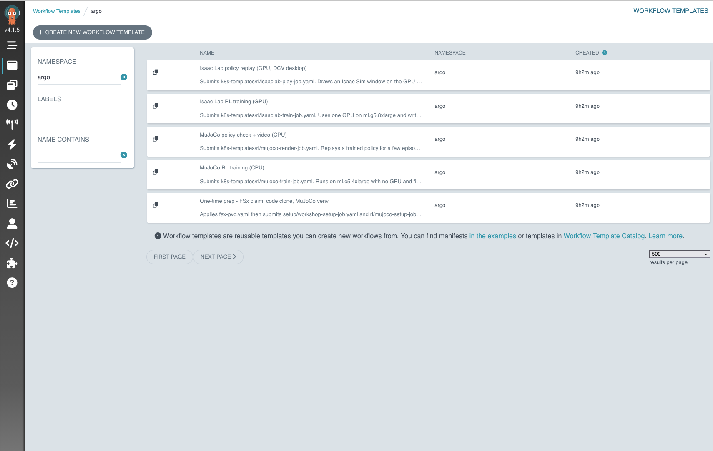

템플릿을 열면 생성될 매니페스트가 보인다. `submit` 단계는 CLI 경로와 같은 `render.sh` 를 부르므로,
여기서 만든 Job 이 셸에서 만든 것과 바이트 단위로 같다.

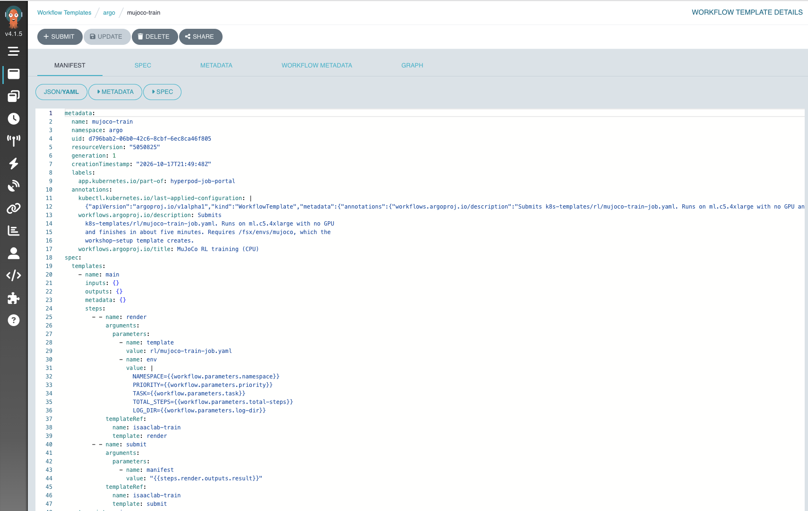

`Workflows` 는 실행 목록이다. 제출한 Workflow 가 phase 와 소요 시간과 함께 나타나고, 왼쪽 요약
패널이 running / pending / succeeded / failed / error 개수를 센다.

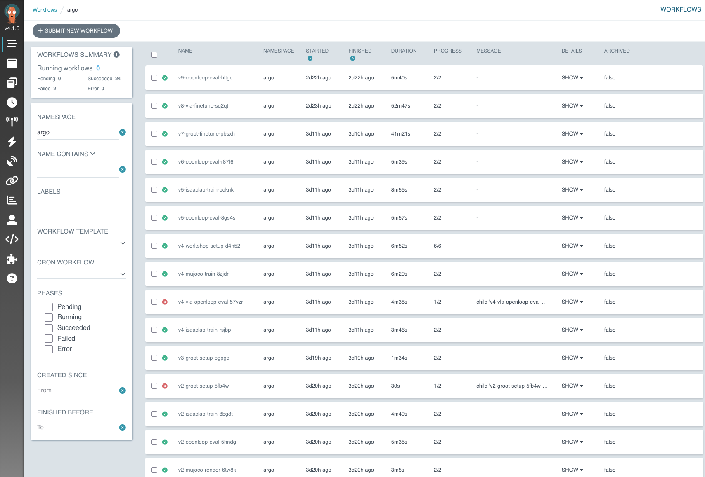

행을 펼치면 조건, 리소스 사용 시간, 어느 템플릿에서 왔는지, 나중에 필터에 쓰는
`workflows.argoproj.io/*` 라벨이 보인다.

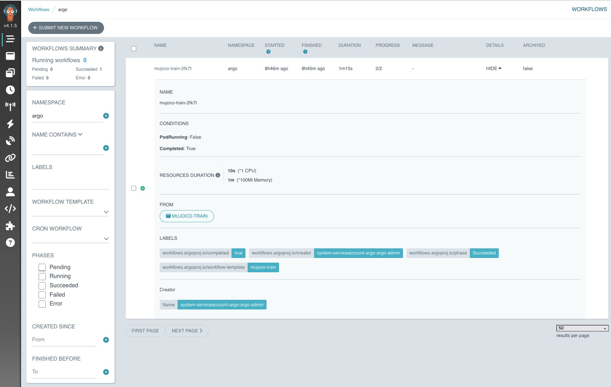

`Logs` 탭은 Job 이 도는 동안 학습 컨테이너의 stdout 을 흘려 준다. 아래쪽 경고를 눈여겨볼 것 —
`ttlSecondsAfterFinished` 가 파드를 지우면 `install-logs.sh` 로 Loki 에 보내 두지 않은 한 이 로그는
사라진다.

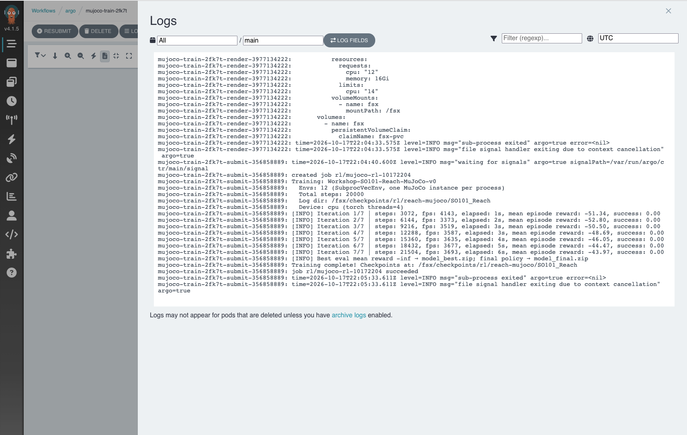

`/` 의 Grafana — 클러스터 상태, 그리고 입구. `install-unified-dashboard.sh` 가 프로비저닝하는
`HyperPod Physical AI — Training Console` 랜딩 대시보드다. 위쪽에 나머지 UI 로 가는 링크가 있고,
아래에 노드·GPU·Kueue 패널과 Postgres 데이터소스로 읽는 MLflow run 패널 몇 개가 놓인다.
"클러스터가 정상인가, 내 Job 이 스케줄됐나" 를 보는 곳이고 학습 곡선을 읽는 곳은 아니다.

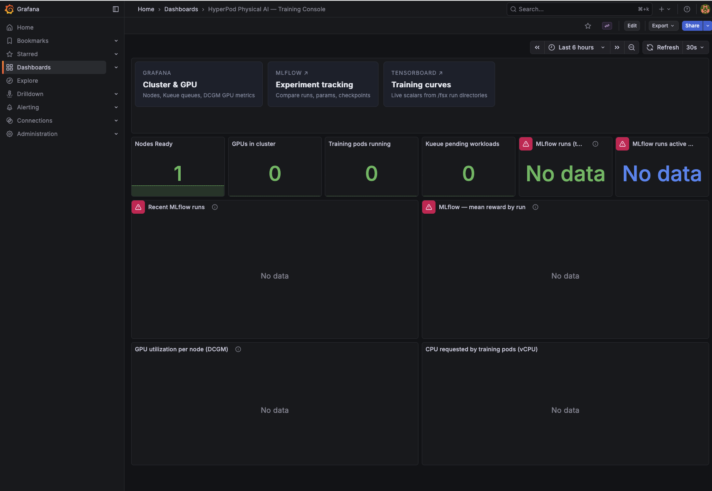

`/mlflow` 의 MLflow — 학습 지표를 읽는 곳. 학습 네임스페이스마다 자기 experiment 에 기록한다.

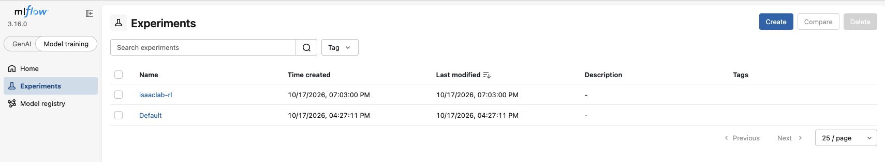

run 의 `Overview` 탭에는 최종 지표값과 템플릿이 넘긴 하이퍼파라미터가 있다. 나중에 두 run 을
비교할 수 있는 근거가 여기다.

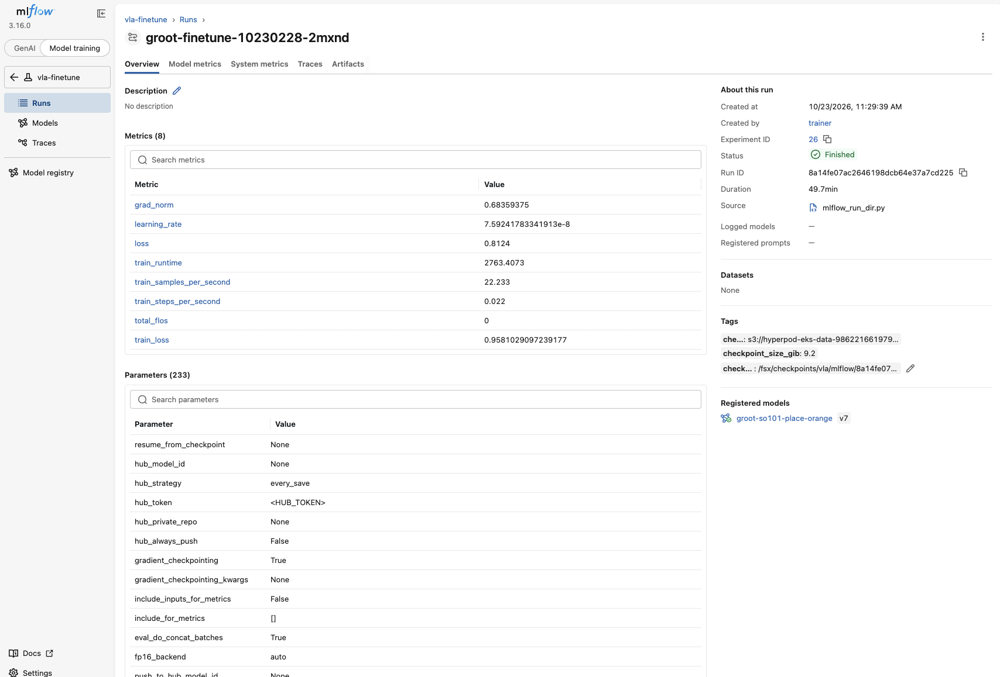

`Model metrics` 는 같은 지표를 스텝별로 그린다. `Auto-refresh` 가 Job 이 도는 동안 차트를 갱신해
주므로, run 을 지켜보는 기본 창은 TensorBoard 가 아니라 여기다.

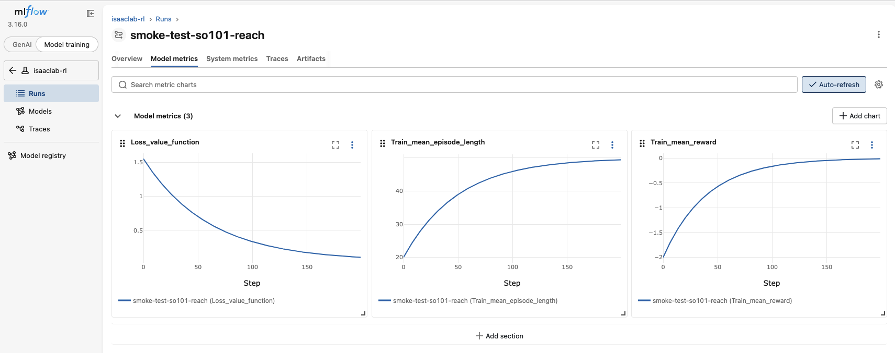

`Artifacts` 에는 스택 S3 버킷의 `mlflow-artifacts/` 아래로 쓰인 체크포인트가 담긴다.

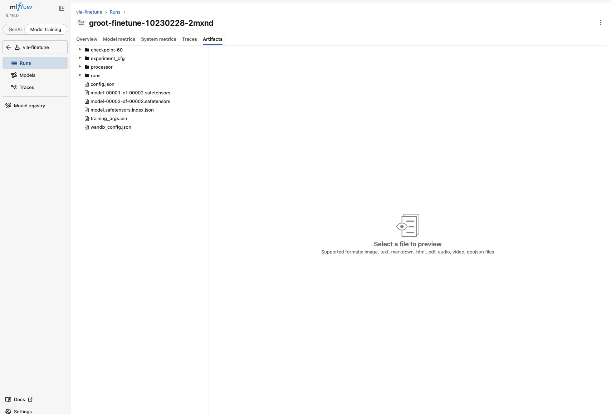

`/tensorboard` 의 TensorBoard — 폴백. `/fsx` 의 tfevents 파일을 직접 읽으므로 MLflow 서버에도,
학습 스크립트의 로깅 코드에도 의존하지 않는다. 아래 곡선은 위 MLflow 스크린샷과 같은 run 의 같은
스칼라 3개다. 그게 요점이다 — MLflow 에 run 이 없을 때만 여기를 열면 된다.

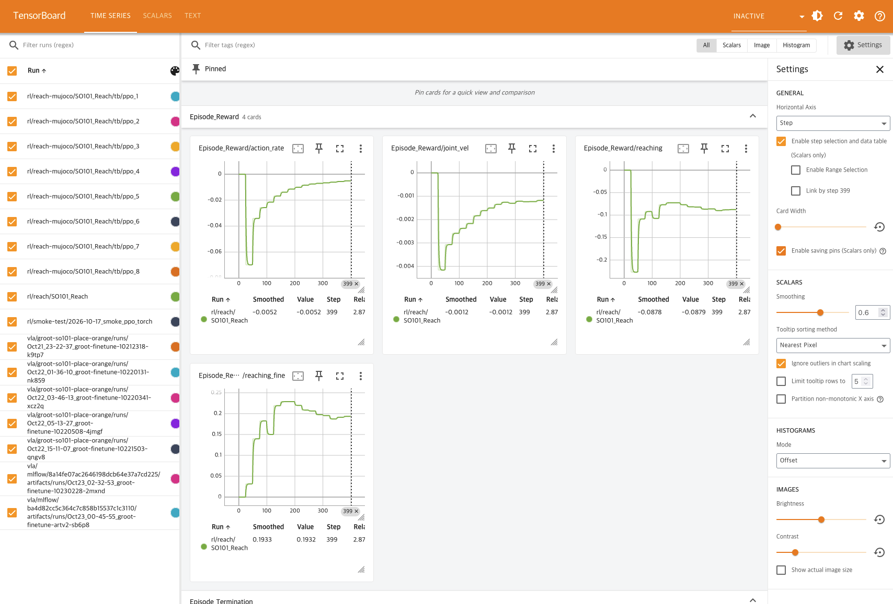

`install-observability.sh` 는 애드온이 그 리전에 있는지(`aws eks describe-addon-versions`) 먼저 확인하고
없으면 대안(`kubectl top`, CloudWatch Container Insights)을 안내하며 종료한다. 2026-10-16 실측으로
`amazon-sagemaker-hyperpod-observability` 는 us-east-1 / us-east-2 / us-west-2 / eu-west-1 /
eu-central-1 / ap-northeast-1 / ap-southeast-1 / ap-southeast-2 / ap-south-1 에 있고 ap-northeast-2(서울)에는
없다. task governance(Kueue) 애드온은 모든 리전에 있어 영향이 없다. 관측을 CDK 스택에서 분리한 이유는,
미지원 리전에서 `CreateAddon` 이 거부되면 CloudFormation 이 스택 전체를 롤백해 VPC·FSx·HyperPod
클러스터까지 함께 되돌리기 때문이다(에러 문구는 Kubernetes 버전을 가리키지만 실제 원인은 리전이라
`eksVersion` 을 낮춰도 똑같이 실패한다).

### Job 제출 (k8s-templates)

모듈 9 (학습·검증): 일반 네임스페이스 `rl`, Kueue 없이 상시 시스템 노드에서 바로 스케줄

```bash
cd hyperpod-training/k8s-templates
./render.sh fsx-pvc.yaml --apply                                   # rl 네임스페이스 생성 + /fsx PV+PVC
./render.sh setup/workshop-setup-job.yaml --apply                  # 최초 1회: 레시피·태스크 패키지를 /fsx 에
./render.sh rl/mujoco-setup-job.yaml --apply                       # 최초 1회: /fsx/envs/mujoco venv (~4분)
TOTAL_STEPS=1000000 ./render.sh rl/mujoco-train-job.yaml --apply   # MuJoCo SO-101 Reach (CPU 12 vCPU, ~5분)
kubectl get jobs,pods -n rl
kubectl logs -n rl -l app=mujoco-rl -f
./render.sh rl/mujoco-render-job.yaml --apply                      # 정책 검증: 성공률 + mp4/gif (OSMesa, ~5분)

# GPU 쿼터가 있는 계정(모듈 10): Isaac Lab
../scripts/scale-cluster.sh gpu-g5-8x 1 --wait --cluster hyperpod-eks-<ACCOUNT_ID>
MAX_ITERATIONS=50 ./render.sh rl/isaaclab-train-job.yaml --apply   # Isaac Lab SO-101 Reach (GPU)
```

모듈 11 (task governance · observability): 팀 네임스페이스 `hyperpod-ns-team-a/b`, Kueue 큐 경유

```bash
../scripts/eks/create-governance.sh                                # cluster policy + team-a / team-b compute quota
../scripts/scale-cluster.sh cpu-c5-4x 2 --wait --cluster hyperpod-eks-<ACCOUNT_ID>   # 두 팀 Job 을 겹치기 위한 CPU 노드 1대 추가 (~3분)
export NAMESPACE=hyperpod-ns-team-a
./render.sh fsx-pvc.yaml --apply                                   # team-a 네임스페이스에 /fsx PV+PVC
NAMESPACE=hyperpod-ns-team-b ./render.sh fsx-pvc.yaml --apply     # team-b
LOG_DIR=/fsx/scratch/governance-demo/team-a PRIORITY=background-priority ./render.sh rl/mujoco-train-job.yaml --apply   # Kueue 라벨이 채워진다
kubectl get workloads -A
```

| 파일 | 역할 |
|---|---|
| `k8s-templates/render.sh` | `${NAMESPACE}` `${QUEUE}` `${PRIORITY}` `${TASK}` 등 치환 + `--apply`. 기본 네임스페이스 `rl`(없으면 생성), `hyperpod-ns-*` 를 주면 Kueue 라벨을 채우고 그 외에는 라벨 줄을 제거 |
| `k8s-templates/fsx-pvc.yaml` | 네임스페이스용 FSx PV+PVC (정적 PV는 PVC 하나에만 바인딩되므로 네임스페이스마다 한 쌍) |
| `k8s-templates/setup/workshop-setup-job.yaml` | 레시피 clone + Isaac Lab 태스크 패키지 배치 (Slurm Slurm 경로 S2 §S2.3 대응) |
| `k8s-templates/rl/isaaclab-train-job.yaml` | `nvcr.io/nvidia/isaac-lab:2.3.0`, `nvidia.com/gpu: 1`, Kueue 라벨 (finetune_isaaclab.sbatch 대응) |
| `k8s-templates/rl/mujoco-setup-job.yaml`, `mujoco-train-job.yaml`, `mujoco-render-job.yaml` | `/fsx/envs/mujoco` venv + SB3 PPO on ml.c5.4xlarge (train_mujoco.sbatch 대응), 정책 검증 영상 (play_mujoco.sbatch 대응) |
| `k8s-templates/governance/*.json` | cluster policy, team-a/team-b compute quota 입력 |
| `scripts/eks/kubeconfig.sh` · `grafana-user.sh` · `create-governance.sh` · `delete-governance.sh` | 접속 · Grafana(AMG) 사용자 · 정책 생성/삭제 |
| `scripts/eks/install-observability.sh` · `delete-observability.sh` | AMP + observability 애드온 + Grafana 추가 설치/삭제 (리전 지원 여부를 먼저 확인). CDK 밖이므로 `cdk destroy` 로는 지워지지 않는다 |
| `scripts/eks/install-dashboard-public.sh` · `delete-dashboard-public.sh` | 클러스터 안의 kube-prometheus-stack + Grafana 를 ALB + WAF + CloudFront 로 공개. observability 애드온이 없는 리전용 경로 |
| `scripts/eks/install-mlflow-selfhosted.sh` · `delete-mlflow-selfhosted.sh` | 같은 ALB 에 클러스터 내부 MLflow + Postgres + TensorBoard. 다른 스크립트들이 의존하는 EBS CSI 애드온과 gp3 StorageClass 도 여기서 만든다 |
| `scripts/eks/install-unified-dashboard.sh` · `delete-unified-dashboard.sh` | Training Console 을 Grafana 홈 대시보드로 지정하고 읽기 전용 MLflow Postgres 데이터소스를 추가 |
| `scripts/eks/install-dashboard-hardening.sh` · `delete-dashboard-hardening.sh` | Prometheus·Grafana 를 gp3 PVC(retention 15d)로 옮기고 SNS 토픽·pod identity·알림 규칙 4개를 프로비저닝 |
| `scripts/eks/install-job-portal.sh` · `delete-job-portal.sh` | 같은 ALB 의 `/argo` 에 Argo Workflows + WorkflowTemplate 8개. 브라우저에서 Job 을 제출한다. 각 submit 단계는 CLI 경로와 똑같은 `render.sh` 를 호출 |
| `scripts/eks/install-logs.sh` · `delete-logs.sh` | Loki(SingleBinary, chunk 는 `s3://<데이터 버킷>/loki/`) + Alloy DaemonSet + Grafana `Loki` 데이터소스. 끝난 Job 의 파드가 수거된 뒤에도 로그가 남는다 |
| `eks/grafana-values.yaml` | in-cluster Grafana Helm values 템플릿 (`install-observability.sh` 가 envsubst 로 채운다) |
| `eks/grafana-dashboards/hyperpod-task-governance.json` | Kueue 대기/실행/선점, ClusterQueue 할당·대여, DCGM GPU 사용률 대시보드 (self-hosted Grafana 에 프로비저닝) |
| `eks/grafana-dashboards/hyperpod-training-console.json` | 클러스터·GPU·MLflow run 패널을 한 화면에 모은 랜딩 대시보드 (`install-unified-dashboard.sh` 가 Grafana 홈으로 지정) |
| `eks/grafana-alerting/hyperpod-alerts.yaml` | Grafana 알림 프로비저닝 — SNS 연락 지점과 `TrainingPodFailed`, `KueueBacklog`, `NodeNotReady`, `GPUIdleWhileAllocated` (`install-dashboard-hardening.sh` 가 토픽 ARN 과 리전을 envsubst 로 채운다) |
| `lifecycle-scripts/on_create_eks.sh` | EKS 노드 lifecycle. CPU 노드는 진단 로그만(kubelet/plugin은 HyperPod·Helm이 처리). GPU 노드는 `setup_nvidia_driver.sh`(Isaac Sim 렌더링용 580 드라이버) + `setup_dcv_al2023.sh`(AL2023 GNOME + DCV, 세션 `workspace`, ec2-user/hyperpod)를 추가 실행 (모듈 10 §10.7 방법 B) |
| `lifecycle-scripts/setup_dcv_al2023.sh` | Amazon Linux 2023(EKS AMI)용 DCV 설치. Slurm AMI(Ubuntu)의 `setup_dcv.sh`에 해당하며 Docker 는 설치하지 않는다 |
| `k8s-templates/rl/isaaclab-play-job.yaml` | GPU 노드 DCV 세션에 Isaac Sim 창을 띄우는 재생 Job (hostPath `/tmp/.X11-unix`, `X_DISPLAY` 자동 선택) |
| `scripts/eks/dcv-target.sh` | GPU 노드의 SSM target 과 DCV 포트포워딩 명령 출력 |
| `eks/helm/HyperPodHelmChart` | vendored HyperPod Helm 의존성 (`VENDOR.md`) |

### 정리

```bash
./scripts/eks/delete-governance.sh                                   # compute quota → cluster policy (남아 있으면 클러스터 삭제가 막힌다)
./scripts/eks/delete-observability.sh                                # AMP·Grafana·애드온 (CDK 밖이라 destroy 로 안 지워진다. AMP 는 비어 있어도 과금)
./scripts/eks/delete-logs.sh                                         # 클러스터 내부 대시보드 경로를 썼다면 역순으로. ALB·WAF 는 상시 과금이다
./scripts/eks/delete-job-portal.sh                                   # 보관된 로그·학습 Job 까지 지우려면 --purge-s3 / --purge-jobs
./scripts/eks/delete-dashboard-hardening.sh
./scripts/eks/delete-unified-dashboard.sh
./scripts/eks/delete-mlflow-selfhosted.sh
./scripts/eks/delete-dashboard-public.sh
./scripts/scale-cluster.sh gpu-g5-8x 0 --cluster hyperpod-eks-<ACCOUNT_ID>
aws s3 rm s3://hyperpod-eks-data-<ACCOUNT_ID>-<REGION> --recursive
cd infra && npx cdk destroy -c orchestrator=eks -c region=${REGION} --force   # ~25분
```

## Step 3: 클러스터 상태 확인

```bash
CLUSTER_NAME="hyperpod-<ACCOUNT_ID>"

# 클러스터 상태
aws sagemaker describe-cluster \
  --cluster-name ${CLUSTER_NAME} \
  --region us-east-1 \
  --query "{Status:ClusterStatus,Groups:InstanceGroups[*].{Name:InstanceGroupName,Count:CurrentCount,Status:Status}}"

# 노드 목록
aws sagemaker list-cluster-nodes \
  --cluster-name ${CLUSTER_NAME} \
  --region us-east-1
```

예상 결과:
```json
{
  "Status": "InService",
  "Groups": [
    { "Name": "head",        "Count": 1, "Status": "InService" },
    { "Name": "gpu-g5-8x",  "Count": 0, "Status": "InService" },
    { "Name": "debug",       "Count": 0, "Status": "InService" }
  ]
}
```

## AMI 보안 패치 (Scheduled Update)

HyperPod AMI에는 커널·NVIDIA 드라이버·OpenSSL 등이 포함되고, AWS가 주기적으로 보안 패치 AMI를 릴리스합니다. 패치하지 않으면 노드는 생성 당시 AMI에 그대로 머무릅니다.

**예약 스케줄은 기본으로 꺼져 있습니다.** `-c amiUpdateSchedule=default`로 배포하면 `DEFAULT_AMI_UPDATE_SCHEDULE`(`lib/config/cluster-config.ts`, 매월 둘째 일요일 18:00 UTC)이 모든 인스턴스 그룹의 `ScheduledUpdateConfig`에 적용됩니다. 단, HyperPod는 한 번 설정된 `ScheduledUpdateConfig`의 수정을 거부하므로 스케줄이 켜진 스택은 이후 `cdk deploy`(노드 수·그룹 변경)가 실패합니다. 워크숍처럼 클러스터를 계속 갱신하는 경우에는 꺼 두고 아래처럼 수동 패치를 쓰세요.

```bash
# 스케줄 확인
aws sagemaker describe-cluster --cluster-name ${CLUSTER_NAME} --region us-east-1 \
  --query "InstanceGroups[].{Name:InstanceGroupName,Schedule:ScheduledUpdateConfig.ScheduleExpression}"

# 마지막 패치 시각 확인 (LaunchTime과 같으면 한 번도 패치되지 않은 것)
aws sagemaker list-cluster-nodes --cluster-name ${CLUSTER_NAME} --region us-east-1 \
  --query "ClusterNodeSummaries[].{Group:InstanceGroupName,Launch:LaunchTime,LastPatch:LastSoftwareUpdateTime}"

# 예약 시각을 기다리지 않고 즉시 패치 (아래 사전 조건을 먼저 확인)
aws sagemaker update-cluster-software --cluster-name ${CLUSTER_NAME} --region us-east-1
```

스케줄을 켜려면 `-c amiUpdateSchedule=default`, 주기를 직접 주려면 `-c amiUpdateSchedule='cron(00 18 1 * ? *)'`를 씁니다.

### 패치 전 반드시 확인할 것

1. **라이프사이클 버킷이 살아 있어야 합니다.** 패치는 루트 볼륨을 새 AMI로 교체한 뒤 `LifeCycleConfig.SourceS3Uri`의 `on_create.sh`를 다시 실행합니다. 버킷이 없으면 패치가 실패하고 클러스터가 `Failed`로 떨어집니다.
   ```bash
   aws s3 ls s3://hyperpod-lifecycle-<account>-<region>/lifecycle-scripts/
   ```
2. **루트 볼륨은 초기화됩니다.** `/fsx`(FSx Lustre)는 유지되지만 `/home/ubuntu`, Slurm accounting DB(mariadb) 등 루트 볼륨 데이터는 사라집니다. 필요하면 AWS 제공 [`patching-backup.sh`](https://github.com/aws-samples/awsome-distributed-training/blob/main/1.architectures/5.sagemaker-hyperpod/patching-backup.sh)로 S3에 백업합니다.
   ```bash
   sudo bash patching-backup.sh --create s3://<backup-bucket-path>   # 패치 전
   sudo bash patching-backup.sh --restore s3://<backup-bucket-path>  # 패치 후
   ```
3. **실행 중인 작업이 없어야 합니다.** Slurm 클러스터는 인스턴스 그룹이 한꺼번에 교체되므로 진행 중인 job은 중단됩니다(`squeue`로 확인).

### Slurm 클러스터의 제약

| 기능 | Slurm | 비고 |
|---|---|---|
| `ScheduledUpdateConfig` (cron 예약) | ✅ | 옵션(`-c amiUpdateSchedule`); 기본 꺼짐 |
| `AutoPatchConfig` (유휴 노드 자동 패치, 워크로드 무중단) | ❌ | **EKS 전용** |
| `DeploymentConfig` (배치 롤링 교체 + CloudWatch 자동 롤백) | ❌ | **EKS 전용** |
| 콘솔에서 Update AMI | ❌ | **EKS 전용**, API/CLI만 가능 |

즉 Slurm에서는 워크로드를 피해가는 패치가 불가능하므로, 예약 시각을 학습이 없는 시간대로 잡는 것이 중요합니다.
참고: [AMI 업데이트 문서](https://docs.aws.amazon.com/sagemaker/latest/dg/sagemaker-hyperpod-release-ami-update.html) · [자동 패치 문서](https://docs.aws.amazon.com/sagemaker/latest/dg/sagemaker-hyperpod-ami-auto-patching.html)

## Step 4: Head Node 접속 (SSH via Jump Host)

CDK 배포 시 Jump Host가 Public Subnet에 생성됩니다. 이를 경유하여 Head Node에 SSH 접속합니다.

### 4.1 SSH 키 다운로드

CDK 출력값의 `JumpKeyCommand`를 실행하여 Jump Host의 SSH 키를 다운로드합니다.

```bash
# Jump Host SSH 키 다운로드
aws ssm get-parameter \
  --name /ec2/keypair/<KEY_PAIR_ID> \
  --with-decryption \
  --query Parameter.Value \
  --output text \
  --region us-east-1 > ~/.ssh/hyperpod-jump.pem

chmod 600 ~/.ssh/hyperpod-jump.pem
```

> `<KEY_PAIR_ID>`는 CDK 출력의 `JumpKeyCommand`에서 확인할 수 있습니다.

### 4.2 Jump Host 접속

```bash
JUMP_IP="<CDK 출력의 JumpHostIp>"

ssh -i ~/.ssh/hyperpod-jump.pem ec2-user@${JUMP_IP}
```

### 4.3 Head Node 접속

Jump Host에는 Head Node 접속용 키(`~/.ssh/cluster_access_key`)가 자동으로 배포되어 있습니다.

```bash
# Jump Host에서 실행
HEAD_IP="<head node private IP>"  # describe-cluster-node으로 확인

ssh -i ~/.ssh/cluster_access_key ubuntu@${HEAD_IP}
```

또는 로컬에서 ProxyJump로 한 번에 접속:
```bash
ssh -i ~/.ssh/hyperpod-jump.pem -o ProxyCommand="ssh -i ~/.ssh/hyperpod-jump.pem -W %h:%p ec2-user@${JUMP_IP}" \
  -i <(aws s3 cp s3://hyperpod-lifecycle-<ACCOUNT_ID>-us-east-1/ssh/cluster_access_key -) \
  ubuntu@${HEAD_IP}
```

### 4.4 SSH Config 설정 (권장)

`~/.ssh/config`에 아래를 추가하면 `ssh hyperpod`로 바로 접속 가능합니다:

```
Host hyperpod-jump
    HostName <JUMP_IP>
    User ec2-user
    IdentityFile ~/.ssh/hyperpod-jump.pem

Host hyperpod
    HostName <HEAD_NODE_PRIVATE_IP>
    User ubuntu
    IdentityFile ~/.ssh/cluster_access_key
    ProxyJump hyperpod-jump
```

> `cluster_access_key`는 Jump Host의 `~/.ssh/cluster_access_key`를 로컬로 복사하거나, S3에서 다운로드합니다:
> ```bash
> aws s3 cp s3://hyperpod-lifecycle-<ACCOUNT_ID>-us-east-1/ssh/cluster_access_key ~/.ssh/cluster_access_key
> chmod 600 ~/.ssh/cluster_access_key
> ```

### 4.5 접속 후 확인

```bash
sinfo                  # SLURM 파티션 상태
df -h /fsx             # FSx 마운트 확인
ls /fsx/               # datasets, checkpoints, scratch 디렉토리
```

## Step 5: 데이터셋 업로드 (S3 → FSx 자동 동기화)

S3에 데이터를 업로드하면 FSx `/fsx/datasets/`에 자동으로 동기화됩니다.

```bash
# 로컬에서 S3로 데이터 업로드
BUCKET="hyperpod-data-<ACCOUNT_ID>-us-east-1"

aws s3 cp ./my-dataset/ s3://${BUCKET}/datasets/groot/my-robot/ --recursive

# 수분 후 head node에서 확인
ls /fsx/datasets/groot/my-robot/
```

### LeRobot v2 형식 데이터셋 구조

```
/fsx/datasets/groot/aloha/
├── meta/
│   ├── info.json
│   ├── episodes.jsonl
│   └── tasks.jsonl
├── data/
│   ├── chunk-000/
│   │   └── episode_000000.parquet
│   └── ...
└── videos/
    ├── chunk-000/
    │   └── observation.images.top/
    │       └── episode_000000.mp4
    └── ...
```

## Step 6: VLA 학습 실행 (GR00T Fine-tuning)

두 오케스트레이션 경로가 FSx 위의 같은 자산을 공유하므로 환경이 갈라지지 않습니다. venv
`/fsx/envs/gr00t`, 릴리스 태그로 고정한 Isaac-GR00T 체크아웃 `/fsx/scratch/Isaac-GR00T`,
파인튜닝 패치 세트 `scripts/patch_groot_repo.py`, 데이터셋 `/fsx/datasets/groot/<DATASET>`,
체크포인트 `/fsx/checkpoints/vla/groot-<DATASET>/checkpoint-<step>` 가 그것입니다. 마지막 경로가
open-loop 평가의 기본 입력이라, 어느 경로에서 만든 체크포인트든 어느 경로에서든 채점할 수 있습니다.

### 최초 1회 준비

```bash
# Slurm: head node 에서 실행
bash /fsx/scratch/aws-physical-ai-recipes/hyperpod-training/scripts/setup_groot_env.sh
bash /fsx/scratch/aws-physical-ai-recipes/hyperpod-training/scripts/prepare_groot_dataset.sh

# EKS: 위 두 스크립트를 한 Job 이 순서대로 돌리고, 파인튜닝이 읽는 경로까지 검증한다
cd hyperpod-training/k8s-templates && ./render.sh setup/groot-setup-job.yaml --apply
```

25~40분 걸리고 멱등이므로, 네트워크 실패 후 다시 돌려도 남은 작업만 수행합니다. 기본값인
`GROOT_VERSION=n1.6` 은 공개 모델이고, `n1.7` 은 gated 모델이라 HuggingFace 토큰이 필요합니다
(Slurm 은 `HF_TOKEN`, EKS 는 `hf-token` Secret).

### 파인튜닝 제출

```bash
# Slurm — venv 모드. HyperPod 에서는 이쪽을 쓴다. 컨테이너 변형은 Pyxis 플러그인이
# 필요한데 관리형 HyperPod 에는 들어 있지 않다.
cd /fsx/scratch/aws-physical-ai-recipes/hyperpod-training
DATASET=so101-place-orange MAX_STEPS=2000 sbatch slurm-templates/vla/finetune_groot_venv.sbatch

# EKS
cd hyperpod-training/k8s-templates
MAX_STEPS=2000 ./render.sh rl/groot-finetune-job.yaml --apply
```

ml.g5.8xlarge(A10G 24 GB) 1장에서 2000 step 약 40분입니다. `GLOBAL_BATCH_SIZE` 를 기본값 32 보다
올리지 마세요. 3B 모델이 들어가는 건 패치 세트가 켜는 gradient checkpointing 과 paged 8-bit
optimizer 덕분이고, 그렇게 남긴 여유분은 이미 쓰이고 있습니다.

### 체크포인트 채점

```bash
# Slurm
sbatch slurm-templates/vla/eval_closed_loop.sbatch

# EKS — action MSE 를 MLflow 실험 vla-eval 에도 기록하고, Grafana 콘솔이 그것을 읽는다
./render.sh rl/openloop-eval-job.yaml --apply
```

### 작업 모니터링

```bash
# Slurm
squeue                                        # 작업 큐 확인
tail -f /fsx/scratch/logs/groot-<JOB_ID>.out  # 실시간 로그
scancel <JOB_ID>                              # 작업 취소

# EKS
kubectl logs -n rl -l app=groot-finetune -f
kubectl delete job -n rl groot-finetune-<SUFFIX>
```

## Step 7: RL 학습 실행 (IsaacLab + Ray)

Actor-Learner 패턴으로 시뮬레이션과 학습을 동시 실행합니다.

```bash
# head node에서 실행
/path/to/slurm-templates/rl/run_rl.sh \
  --env Isaac-Cartpole-v0 \
  --num-actors 8

# 출력 예시:
# === RL Training: Isaac-Cartpole-v0 ===
#   Actors: 8
#   Learner job: 123
#   Actor jobs: 124 (array 0-7)
```

## Step 8: MLflow로 실험 추적

### MLflow 설정

```bash
# head node에서 MLflow 클라이언트 설치
pip install mlflow sagemaker-mlflow boto3

# 트래킹 URI 설정 (CDK 출력값 사용)
export MLFLOW_TRACKING_URI="https://us-east-1.experiments.sagemaker.aws/mlflow/hyperpod-<ACCOUNT_ID>-mlflow"
```

### MLflow UI 접근

SageMaker Managed MLflow UI는 CDK 배포 시 출력되는 `MLflowTrackingUri`로 접근합니다:
```
https://us-east-1.experiments.sagemaker.aws/mlflow/hyperpod-<ACCOUNT_ID>-mlflow
```

### 학습 코드에서 MLflow 사용

```python
import mlflow

mlflow.set_tracking_uri(os.environ["MLFLOW_TRACKING_URI"])
mlflow.set_experiment("groot-finetune")

with mlflow.start_run():
    mlflow.log_params({"lr": 2e-5, "batch_size": 32})
    # ... 학습 루프 ...
    mlflow.log_metrics({"loss": 0.01, "accuracy": 0.95}, step=1000)
```

## Step 9: 체크포인트 확인 (FSx → S3 자동 익스포트)

학습 결과가 `/fsx/checkpoints/`에 저장되면 S3로 자동 익스포트됩니다. FSx DRA의
AutoExportPolicy가 하는 일이므로 복사 명령은 필요 없습니다. Argo 포털로 제출했다면
`submit` 단계 로그 마지막에 그 Job의 FSx/S3 경로와 `aws s3 ls` 명령이 그대로 찍힙니다.

```bash
# 버킷 이름은 스택 Output 에서 읽는다 (1계정 1클러스터 규약)
BUCKET=$(aws cloudformation describe-stacks \
  --stack-name HyperPodEks-$(aws sts get-caller-identity --query Account --output text) \
  --query "Stacks[0].Outputs[?OutputKey=='S3BucketName'].OutputValue|[0]" --output text)

# FSx에서 확인 (헤드 노드 또는 /fsx 를 마운트한 파드)
ls /fsx/checkpoints/vla/groot-so101-place-orange/

# S3에서 확인 (익스포트는 수십 초 안에 끝난다)
aws s3 ls s3://${BUCKET}/checkpoints/vla/groot-so101-place-orange/ --recursive

# 로컬로 내리기
aws s3 sync s3://${BUCKET}/checkpoints/vla/groot-so101-place-orange/checkpoint-2000/ ./checkpoint-2000/
```

### UI에서 체크포인트 찾기

두 포털 모두 "이 run의 가중치가 어디로 갔나"에 답하지만 범위가 다릅니다. Argo는
실행 하나에 대해, MLflow는 여러 실행을 가로질러 답합니다.

Argo UI에서는 워크플로를 열고 `submit` 노드를 클릭해 OUTPUTS 패널을 봅니다.

```
artifact-fsx-dir   /fsx/checkpoints/vla/groot-so101-place-orange
artifact-s3-uri    s3://<bucket>/checkpoints/vla/groot-so101-place-orange/
```

산출물이 없는 Job(setup, play)은 `(none)`으로 표시됩니다. Argo 레코드는 워크플로의
`ttlSecondsAfterFinished`와 함께 사라지므로, 방금 제출한 실행을 확인하는 용도입니다.

MLflow UI에서는 Models를 엽니다. 파인튜닝마다 `groot-<dataset>` 모델의 버전이
등록되고, `source`가 위의 S3 경로이며 어느 step·어느 Job의 산출물인지가 태그로
남습니다.

```
source             s3://<bucket>/checkpoints/vla/groot-so101-place-orange/checkpoint-2000/
fsx_dir            /fsx/checkpoints/vla/groot-so101-place-orange/checkpoint-2000
checkpoint_step    2000
groot_version      n1.6
job_name           groot-finetune-10220131
```

버전은 학습 run에 연결되고, 그 run에도 위치가 태그로 남으므로 loss 곡선과
경로가 한 레코드에 모입니다.

```
checkpoint_s3_uri     s3://<bucket>/checkpoints/vla/groot-so101-place-orange/checkpoint-2000/
checkpoint_fsx_dir    /fsx/checkpoints/vla/groot-so101-place-orange/checkpoint-2000
checkpoint_size_gib   9.2
```

가중치는 업로드하지 않습니다. FSx가 `/fsx/checkpoints`를 S3로 자동 익스포트하므로
같은 바이트가 이미 버킷에 있고, 추적 서버가 요청을 받으면 그 경로에서 직접
읽어 내려줍니다.

```bash
# 등록된 체크포인트의 아무 파일이나, MLflow가 직접 서빙한다
curl -u "$USER:$PASS" -O \
  "https://<domain>/mlflow/model-versions/get-artifact?name=groot-so101-place-orange&version=3&path=config.json"

# 또는 MLflow를 거치지 않고 S3·FSx에서 바로
aws s3 sync s3://<bucket>/checkpoints/vla/groot-so101-place-orange/checkpoint-2000/ ./ckpt/
ls /fsx/checkpoints/vla/groot-so101-place-orange/checkpoint-2000
```

MLflow를 통한 서빙이 되는 이유는 MLflow 파드 role이 `checkpoints/*`에 대한
`s3:GetObject`를 갖기 때문이며, `install-mlflow-selfhosted.sh`가 부여합니다.
체크포인트 하나가 약 9 GiB이고 그중 3 GiB 정도는 추론에 필요 없는 optimizer
state이므로, 가중치만 받으려면 `--exclude 'optimizer.pt' --exclude
'scheduler.pt'`를 붙입니다.

승급은 사람이 합니다. UI에서 버전을 고르고 alias(예: `production`)를 지정합니다.
Step 8의 평가가 내는 open-loop MSE는 정책이 시연을 얼마나 그대로 재현하는지를
재는 값이고 태스크 성공 여부가 아니므로, 단독으로 릴리스 게이트가 될 수 없습니다.

## Step 10: 리소스 정리

CloudFormation은 빈 버킷만 삭제한다. destroy 시점에 두 버킷은 비어 있지 않으므로(lifecycle 버킷: 스택이 올린 스크립트 + 클러스터가 기록한 `config/head_ip.txt`, 데이터 버킷: FSx에서 동기화된 체크포인트/데이터셋) **먼저 비우고 destroy 한다.**

```bash
ACCOUNT_ID=$(aws sts get-caller-identity --query Account --output text)
REGION=us-east-1

# 1) S3 버킷 두 개 비우기 (필수)
aws s3 rm s3://hyperpod-data-${ACCOUNT_ID}-${REGION} --recursive --region ${REGION}
aws s3 rm s3://hyperpod-lifecycle-${ACCOUNT_ID}-${REGION} --recursive --region ${REGION}

# 2) 스택 삭제 (클러스터 + FSx + Jump Host + VPC, 약 20분)
cd hyperpod-training/infra
npx cdk destroy -c region=${REGION} --force
```

스택이 `DELETE_FAILED`(The bucket you tried to delete is not empty)로 끝나면 — 1)을 건너뛰었거나, 데이터 버킷의 버저닝 때문에 이전 버전·삭제 마커가 남은 경우 — 실패한 버킷의 모든 버전을 지우고 삭제를 재실행한다. 이 시점에 클러스터·FSx·NAT GW·Jump Host는 이미 삭제돼 있다.

```bash
aws cloudformation describe-stack-events --stack-name HyperPod-${ACCOUNT_ID} --region ${REGION} \
  --query "StackEvents[?ResourceStatus=='DELETE_FAILED'].[LogicalResourceId,PhysicalResourceId]" --output table

BUCKET=hyperpod-data-${ACCOUNT_ID}-${REGION}   # 또는 hyperpod-lifecycle-${ACCOUNT_ID}-${REGION}
aws s3api list-object-versions --bucket $BUCKET --region ${REGION} \
  --query '{Objects: [Versions[].{Key:Key,VersionId:VersionId}, DeleteMarkers[].{Key:Key,VersionId:VersionId}][] }' \
  --output json > /tmp/versions.json
aws s3api delete-objects --bucket $BUCKET --region ${REGION} --delete file:///tmp/versions.json

aws cloudformation delete-stack --stack-name HyperPod-${ACCOUNT_ID} --region ${REGION}
aws cloudformation wait stack-delete-complete --stack-name HyperPod-${ACCOUNT_ID} --region ${REGION}
```

워크숍 참가자용 절차는 콘텐츠 모듈 12 §12.7B와 동일하다.

---

## 트러블슈팅

### 배포 실패: "Unable to retrieve subnets"
- Execution Role에 EC2 VPC 권한 필요 → CDK에 이미 포함됨

### 배포 실패: "InstanceGroups must have a SlurmConfig with Controller node type"
- head 그룹에 `SlurmConfig: { NodeType: Controller }` 필요 → CDK에 이미 포함됨

### SSM 접속 안 됨
- AWS Console에서 접속하세요 (SageMaker > HyperPod > Clusters > Connect)
- CLI 접속에는 session-manager-plugin 설치 필요

### FSx 마운트 안 됨
- Lifecycle script의 FSX_DNS_NAME/FSX_MOUNT_NAME이 설정되어야 함
- 클러스터 생성 후 FSx 정보를 lifecycle script에 설정 필요

### MLflow "already exists" 에러
- 이전 배포에서 MLflow 서버가 남아있음
- `aws sagemaker delete-mlflow-tracking-server --tracking-server-name <name>` 후 재배포

### 패치 실패: "The lifecycle configuration bucket ... was not found or does not exist"
- 라이프사이클 스크립트 버킷이 삭제된 상태에서 `update-cluster-software`를 호출한 경우
- 클러스터가 `SystemUpdating` → `RollingBack` → `Failed`로 떨어짐 (노드는 교체 전에 중단되므로 데이터는 보존됨)
- 복구: 같은 이름으로 버킷을 다시 만들고 스크립트를 올린 뒤 패치를 재시도
  ```bash
  B=hyperpod-lifecycle-<account>-us-east-1
  aws s3api create-bucket --bucket $B --region us-east-1 \
    --create-bucket-configuration LocationConstraint=us-east-1
  aws s3 cp lifecycle-scripts/ s3://$B/lifecycle-scripts/ --recursive --exclude "*" --include "*.sh"
  printf '%s' "$B" | aws s3 cp - s3://$B/lifecycle-scripts/bucket.conf
  aws sagemaker update-cluster-software --cluster-name <cluster> --region us-east-1
  ```
- 예방: 버킷에 삭제 방지를 걸거나, 패치 전 사전 점검 항목으로 버킷 존재를 확인

### S3 버킷 삭제 실패
- 버킷이 비어있지 않으면 삭제 불가
- `aws s3 rm s3://<bucket-name> --recursive` 후 스택 삭제 재시도

---

## 비용 참고

| 컴포넌트 | 시간당 비용 | 비고 |
|---------|------------|------|
| Head Node (ml.m5.xlarge) | ~$0.20 | 상시 운영 |
| Train (gpu-g5-8x, ml.g5.8xlarge) | ~$3.00 | 학습 시에만 |
| Debug (ml.g5.8xlarge) | ~$3.00 | 시각 검증 시에만 |
| FSx (1.2TB) | ~$0.55 | 상시 |
| MLflow | ~$0.10 | 상시 |
| **실습 중 (head only)** | **~$0.85/hr** | |
| **학습 실행 시** | **~$8-10/hr** | |

실습 후 반드시 `cdk destroy`로 정리하세요.

---

## 다음 단계

- [아키텍처 상세 문서](./docs/architecture.md)
- [리서처 가이드](./docs/researcher_guide.md)
- [VLA 학습 예제](./examples/vla/)
- [RL 학습 예제](./examples/rl/)
- [SLURM 템플릿](./slurm-templates/)
